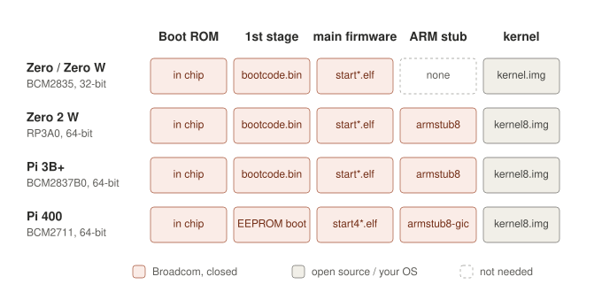

# Broadcom's firmware: what is in it, per Pi model

The aim of this repository is to replace everything closed from Broadcom
on the Pi, as far as possible, not only the VPU boot firmware. This page
lists what the closed Raspberry Pi firmware consists of, which variant each
model uses, and what each piece does. Sizes are from the release
redox-rpi uses, [raspberrypi/firmware](https://github.com/raspberrypi/firmware)
`1.20260915`. Which of these pieces our own firmware replaces:
[own-firmware.md](own-firmware.md); how redox-rpi's releases start:
[boot-chain.md](boot-chain.md).

## Firmware per model

The boards themselves (chip, cores, memory, USB, network):
[models.md](models.md).

| | Pi Zero / Zero W | Pi Zero 2 W | Pi 3B+ | Pi 400 | Pi 5 / CM5 |
|---|---|---|---|---|---|
| First boot code after the ROM | `bootcode.bin` on the SD card | `bootcode.bin` on the SD card | `bootcode.bin` on the SD card, or over USB or the network (in the ROM) | bootloader in the SPI EEPROM on the board | bootloader in the SPI EEPROM |
| Main firmware | `start*.elf` + `fixup*.dat` | `start*.elf` + `fixup*.dat` | `start*.elf` + `fixup*.dat` | `start4*.elf` + `fixup4*.dat` | in the EEPROM too; no `start*.elf` on the card |
| ARM start stub | none needed (one core) | `armstub8` built into `start.elf` | `armstub8` built into `start.elf` | `armstub8-gic` built into `start4.elf` (sets up the GIC-400) | TF-A's BL31, built into the firmware: gives PSCI |
| Devicetree | `bcm2708-rpi-zero.dtb`, `bcm2708-rpi-zero-w.dtb` | `bcm2710-rpi-zero-2-w.dtb` | `bcm2710-rpi-3-b-plus.dtb` | `bcm2711-rpi-400.dtb` | `bcm2712-rpi-5-b.dtb`; CM5 on the IO board: `bcm2712-rpi-cm5-cm5io.dtb` |
| Other blobs | Wi-Fi/Bluetooth chip firmware (Zero W) | Wi-Fi/Bluetooth chip firmware | Wi-Fi/Bluetooth chip firmware | Wi-Fi/Bluetooth chip firmware; USB controller (VL805) firmware loaded by the EEPROM bootloader | Wi-Fi/Bluetooth chip firmware; the RP1 I/O chip runs its own firmware (from the bootloader, not checked) |

The Wi-Fi and Bluetooth firmware belongs to the Cypress/Infineon radio
chip and is loaded by the operating system's driver, not by the boot
firmware. redox-rpi has no Wi-Fi driver yet.

## Every closed piece and whether it can be replaced

Everything on these boards that comes as closed code. Most is from
Broadcom; the Wi-Fi chip is Cypress/Infineon (Broadcom's former Wi-Fi
business).

| Closed piece | Models | Runs on | Replaceable? | Our plan |
|---|---|---|---|---|
| Boot ROM | all | VPU, in the chip | **no**: part of the silicon | stays; it is small and only loads the next stage |
| `bootcode.bin` | Zero, Zero 2 W, 3B+ | VPU | **yes** | our `bootcode.bin`, M1 passed |
| `start*.elf` + `fixup*.dat`, boot part (clocks, memory split, loading, ARM start) | all up to the Pi 4/400 | VPU | **yes** | M2 |
| `start*.elf`, run-time part: mailbox (memory, MAC, clocks, temperature, power) | all up to the Pi 4/400 | VPU | **yes** | M3, a small service on the VPU, or the ARM side does it itself |
| `start*.elf`, display (HDMI, framebuffer, composite) | all up to the Pi 4/400 | VPU | **yes**, with effort: the registers are partly documented by Linux's `vc4` driver | M4 |
| `start*.elf`, 3D memory and power (V3D) | all up to the Pi 4/400 | VPU | **yes**: V3D itself is open (Mesa, Linux) | M5 |
| `start*.elf`, video codecs (H.264, MPEG-2, VC-1), camera ISP (`start_x`) | all up to the Pi 4/400 | VPU | **hardly**: undocumented, depends on the rest of the closed firmware | software decoding on the ARM instead; camera not planned |
| `armstub*` | Zero 2 W, 3B+, Pi 4/400 | ARM | **already open** (BSD source), only built in | our own build of `armstub8`, done |
| Wi-Fi firmware (`brcmfmac*.bin`, the chip's NVRAM text, CLM blob) | Zero W, Zero 2 W, 3B+, Pi 4/400 | inside the Wi-Fi chip | **no** in practice: the chip's own processor, no documentation; the open-source driver on the host side is enough | load the blob; write our own driver for it (redox-rpi Wi-Fi theme) |
| Bluetooth firmware patch (`*.hcd`) | same | inside the radio chip | **no** in practice | load the patch, or run Bluetooth without it (may work with the ROM version) |
| EEPROM bootloader (`pieeprom.bin`, `recovery.bin`); on the Pi 5 it holds the main firmware too | Pi 4, 400, 5, CM5 | VPU / boot processor | **maybe**: lk-overlay has some Pi 4 work; replacing it needs a safe way back | later, a separate experiment (see [other-models.md](other-models.md)) |
| RP1 I/O chip firmware (USB, Ethernet MAC, GPIO) | Pi 5, CM5 | inside RP1 (Raspberry Pi's own chip) | **unknown**: RP1 is documented in part (Raspberry Pi's RP1 peripherals document), its firmware is not | keep for now |
| VL805 USB controller firmware | Pi 4 (Pi 400: probably the same, not checked) | inside the VL805 (VIA) | **no**: not Broadcom, no documentation | keep |

Open already: devicetrees and overlays, U-Boot, the Redox bootloader and
kernel. The 3B+'s USB/Ethernet chip (LAN7515) and its power chip
(MxL7704) need no firmware.

So on the 3B+ everything closed except the Boot ROM and the radio
firmware can in principle be replaced. The video codecs are the one piece
we would rather leave out than rebuild.

## The pieces

### Boot ROM (all models)

Inside the chip, cannot be changed or replaced, and cannot be broken.

- **Zero, Zero 2 W, 3B+:** looks for `bootcode.bin` on the SD card's
  first FAT partition. The 3B+ also tries USB and the network when there
  is none (set at the factory). The ROM loads at most 128 KiB into the
  VPU's L2 cache at `0x80000000` and jumps to `0x80000200`.
- **Pi 4, 400 and 5:** reads the bootloader from the SPI EEPROM. If the
  EEPROM is broken, it looks for `recovery.bin` on the SD card to
  rewrite it.

### `bootcode.bin` (not on the Pi 4, 400 and 5)

52 KB, runs in the VPU's L2 cache. Sets up the clocks and the SDRAM, then
loads `start*.elf` and `fixup*.dat`. It also does USB and network boot
(about a third of its register accesses are USB), and reads `config.txt`
for a few early settings (`gpu_mem`, `total_mem`, `start_file`). One file
for all VideoCore IV models.

On the Pi 4, 400 and 5 the **EEPROM bootloader** has this job instead. On the Pi 5 and CM5 the EEPROM also holds the main firmware, so the card carries no `start*.elf`. It
also knows network, USB and NVMe boot, and has its own settings
(`rpi-eeprom-config`, for example `BOOT_ORDER`).

### `start*.elf` and `fixup*.dat` (the main firmware)

The real firmware, about 0.8 to 3 MB. It runs on the VPU on top of the
ThreadX real-time OS and **keeps running** after the ARM has started.

What it does at boot:

- reads `config.txt` and `cmdline.txt`;
- sets the clocks and voltages;
- splits the memory between the ARM and the GPU (`gpu_mem`);
- sets up HDMI and a framebuffer;
- loads the devicetree and its overlays, fills in memory size, MAC
  address and serial number;
- loads the kernel (or U-Boot) and the stub, and starts the ARM.

After boot it answers the ARM over the **mailbox**: temperature, clocks,
throttling, framebuffer, power domains, board data. It also runs the
video codecs, the camera pipeline and the 3D memory management, reached
over VCHIQ.

`fixup*.dat` is the relocation data that adjusts the matching
`start*.elf` to the memory split. It always comes in a pair with its
`start*.elf`.

**Variants:** `config.txt` picks one (`start_x=1`, `start_debug=1`), and
`gpu_mem=16` picks the cut-down one automatically.

| VideoCore IV (Zero, Zero 2 W, 3B+) | VideoCore VI (Pi 4, 400) | What | Size (IV) |
|---|---|---|---|
| `start.elf` + `fixup.dat` | `start4.elf` + `fixup4.dat` | standard | 3.0 MB |
| `start_x.elf` + `fixup_x.dat` | `start4x.elf` + `fixup4x.dat` | plus camera and more codecs | |
| `start_cd.elf` + `fixup_cd.dat` | `start4cd.elf` + `fixup4cd.dat` | cut-down: no 3D, codecs or camera, for `gpu_mem=16`; **redox-rpi uses this one** on the 3B+ and Zero 2 W | 0.8 MB |
| `start_db.elf` + `fixup_db.dat` | `start4db.elf` + `fixup4db.dat` | debug output | |

The Pi 400 image of redox-rpi uses `start4.elf` (2.3 MB) for now.

### ARM start stubs (`armstub*`)

A few hundred bytes of ARM code that run first on the ARM, in the most
privileged mode. They set the timer frequency and the SMP bit, drop to
the level the kernel expects, and park cores 1–3 in a spin table until
the kernel releases them. Source: `armstubs/` in
[raspberrypi/tools](https://github.com/raspberrypi/tools/tree/master/armstubs)
(BSD).

| Stub | For | Model |
|---|---|---|
| none | single core, the firmware starts the kernel directly | Zero, Zero W |
| `armstub7` | 32-bit kernel on a multi-core chip | Zero 2 W, 3B+ (redox-rpi does not use it) |
| `armstub8` | 64-bit kernel, `arm_64bit=1` | Zero 2 W, 3B+ |
| `armstub8-gic` | 64-bit kernel, plus GIC-400 interrupt controller set-up | Pi 4, 400 |

They are built into `start*.elf`. `armstub=<file>` in `config.txt` loads
a different one from the card. Our own `armstub8` is one of these
([own-firmware.md](own-firmware.md#m2-arm-start-and-armstub8)).

### Devicetree and overlays

Open source, from the Raspberry Pi Linux tree, one `.dtb` per model (see
the table above). Overlays (`overlays/*.dtbo`) change it at boot from
`config.txt`. For example, redox-rpi uses `disable-bt` (the PL011 UART
for the serial console) and `mmc` (the SD card on the Arasan
controller). The firmware adds the memory size, MAC address and serial
number before it starts the kernel.

### `LICENCE.broadcom`

The terms under which the closed files may be passed on. It has to come
with every card or archive that contains them.

## Which files redox-rpi puts on a card

| Model | Files from Broadcom's release |
|---|---|
| 3B+, Zero 2 W | `bootcode.bin`, `start.elf`, `fixup.dat`, `start_cd.elf`, `fixup_cd.dat`, `LICENCE.broadcom`, `bcm2710-rpi-3-b.dtb`, `bcm2710-rpi-3-b-plus.dtb`, `bcm2710-rpi-zero-2-w.dtb`, `overlays/disable-bt.dtbo`, `overlays/mmc.dtbo` (redox-rpi `scripts/rpi-firmware.sh`) |
| Pi 400 (bring-up) | `start4.elf`, `fixup4.dat`, `LICENCE.broadcom`, `bcm2711-rpi-400.dtb` (and the 4B and CM4 devicetrees), overlays; the bootloader is in the board's EEPROM |
