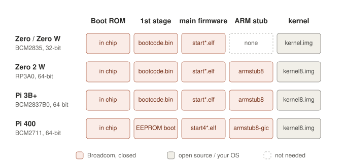

# Broadcom's firmware

One page for every file of Broadcom's Raspberry Pi firmware that a redox-rpi
card carries, plus the variants it doesn't carry. Each page says what is
inside the file, as far as we can see without running it.

All numbers are from release `1.20260915` of
[raspberrypi/firmware](https://github.com/raspberrypi/firmware), the one
redox-rpi uses (`scripts/rpi-firmware.sh` in redox-rpi). They were read
with `readelf`, `strings`, `xxd` and `dtc` on 2026-11-14. Which models use
which pieces is further down. The chip they run on:
[hardware/pi3b-plus.md](../hardware/pi3b-plus.md).

| File | Size | Runs on | Page |
|---|---|---|---|
| `bootcode.bin` | 52,624 B | VPU, from L2 cache | [bootcode.bin.md](bootcode.bin.md) |
| `start.elf` | 3,023,104 B | VPU, from SDRAM, stays running | [start.elf.md](start.elf.md) |
| `start_cd.elf` | 844,380 B | VPU, from SDRAM, stays running | [start_cd.elf.md](start_cd.elf.md) |
| `start_x.elf` | not on our cards | VPU | [start_x.elf.md](start_x.elf.md) |
| `start_db.elf` | not on our cards | VPU | [start_db.elf.md](start_db.elf.md) |
| `fixup.dat`, `fixup_cd.dat` (and `fixup_x`, `fixup_db`) | 7,381 B, 3,280 B | read by `bootcode.bin` | [fixup.dat.md](fixup.dat.md) |
| `armstub8` | built into `start*.elf` | ARM, EL3 | [armstub8.md](armstub8.md) |
| `bcm2710-rpi-3-b-plus.dtb` (and the 3B and Zero 2 W ones) | 35,252 B | read by `start*.elf`, used by the kernel | [bcm2710-rpi-3-b-plus.dtb.md](bcm2710-rpi-3-b-plus.dtb.md) |
| `overlays/disable-bt.dtbo` | 1,073 B | applied by `start*.elf` | [disable-bt.dtbo.md](disable-bt.dtbo.md) |
| `overlays/mmc.dtbo` | 1,221 B | applied by `start*.elf` | [mmc.dtbo.md](mmc.dtbo.md) |
| `LICENCE.broadcom` | 1,594 B | – | [LICENCE.broadcom.md](LICENCE.broadcom.md) |

The order they act in at power-on: Boot ROM → `bootcode.bin` →
`start*.elf` with `fixup*.dat` → devicetree and overlays → `armstub8` →
U-Boot (or the kernel). `start*.elf` keeps running on the VPU afterwards
and answers the ARM over the mailbox.

## How we look at them

- Only what the files show on their own: headers, section tables,
  embedded strings, data layouts. The licence allows using and passing
  them on unmodified; it says nothing about reading them.
- Findings from our internal disassembly of `bootcode.bin` are behaviour
  only (register order, decisions), never code. They are in
  [own-firmware.md](../own-firmware.md#findings-from-the-closed-bootcodebin)
  and in the `bootcode/` README.
- Where something is the usual community reading rather than something we
  checked, the page says so.

## Firmware per model

The boards themselves (chip, cores, memory, USB, network):
[models.md](../models.md).

| | Pi Zero / Zero W | Pi Zero 2 W | Pi 3B+ | Pi 400 | Pi 5 / CM5 |
|---|---|---|---|---|---|
| First boot code after the ROM | `bootcode.bin` on the SD card | `bootcode.bin` on the SD card | `bootcode.bin` on the SD card, or over USB or the network (in the ROM) | bootloader in the SPI EEPROM on the board | bootloader in the SPI EEPROM |
| Main firmware | `start*.elf` + `fixup*.dat` | `start*.elf` + `fixup*.dat` | `start*.elf` + `fixup*.dat` | `start4*.elf` + `fixup4*.dat` | in the EEPROM too; no `start*.elf` on the card |
| ARM start stub | none needed (one core) | `armstub8` built into `start.elf` | `armstub8` built into `start.elf` | `armstub8-gic` built into `start4.elf` (sets up the GIC-400) | TF-A's BL31, built into the firmware: gives PSCI |
| Devicetree | `bcm2708-rpi-zero.dtb`, `bcm2708-rpi-zero-w.dtb` | `bcm2710-rpi-zero-2-w.dtb` | `bcm2710-rpi-3-b-plus.dtb` | `bcm2711-rpi-400.dtb` | `bcm2712-rpi-5-b.dtb`; CM5 on the IO board: `bcm2712-rpi-cm5-cm5io.dtb` |
| Other blobs | Wi-Fi/Bluetooth chip firmware (Zero W) | Wi-Fi/Bluetooth chip firmware | Wi-Fi/Bluetooth chip firmware | Wi-Fi/Bluetooth chip firmware; USB controller (VL805) firmware loaded by the EEPROM bootloader | Wi-Fi/Bluetooth chip firmware; the RP1 I/O chip runs its own firmware (from the bootloader, not checked) |

The Wi-Fi and Bluetooth firmware belongs to the Cypress/Infineon radio
chip and is loaded by the operating system's driver, not by the boot
firmware. redox-rpi has no Wi-Fi driver yet.

## Every closed piece and whether it can be replaced

Everything on these boards that comes as closed code. Most is from
Broadcom; the Wi-Fi chip is Cypress/Infineon (Broadcom's former Wi-Fi
business).

| Closed piece | Models | Runs on | Replaceable? |
|---|---|---|---|
| Boot ROM | all | VPU, in the chip | **no**: part of the silicon |
| `bootcode.bin` | Zero, Zero 2 W, 3B+ | VPU | **yes** |
| `start*.elf` + `fixup*.dat`, boot part (clocks, memory split, loading, ARM start) | all up to the Pi 4/400 | VPU | **yes** |
| `start*.elf`, run-time part: mailbox (memory, MAC, clocks, temperature, power) | all up to the Pi 4/400 | VPU | **yes** |
| `start*.elf`, display (HDMI, framebuffer, composite) | all up to the Pi 4/400 | VPU | **yes**, with effort: the registers are partly documented by Linux's `vc4` driver |
| `start*.elf`, 3D memory and power (V3D) | all up to the Pi 4/400 | VPU | **yes**: V3D itself is open (Mesa, Linux) |
| `start*.elf`, video codecs (H.264, MPEG-2, VC-1), camera ISP (`start_x`) | all up to the Pi 4/400 | VPU | **hardly**: undocumented, depends on the rest of the closed firmware |
| `armstub*` | Zero 2 W, 3B+, Pi 4/400 | ARM | **already open** (BSD source), only built in |
| Wi-Fi firmware (`brcmfmac*.bin`, the chip's NVRAM text, CLM blob) | Zero W, Zero 2 W, 3B+, Pi 4/400 | inside the Wi-Fi chip | **no** in practice: the chip's own processor, no documentation; the open-source driver on the host side is enough |
| Bluetooth firmware patch (`*.hcd`) | same | inside the radio chip | **no** in practice |
| EEPROM bootloader (`pieeprom.bin`, `recovery.bin`); on the Pi 5 it holds the main firmware too | Pi 4, 400, 5, CM5 | VPU / boot processor | **maybe**: lk-overlay has some Pi 4 work; replacing it needs a safe way back |
| RP1 I/O chip firmware (USB, Ethernet MAC, GPIO) | Pi 5, CM5 | inside RP1 (Raspberry Pi's own chip) | **unknown**: RP1 is documented in part (Raspberry Pi's RP1 peripherals document), its firmware is not |
| VL805 USB controller firmware | Pi 4 (Pi 400: probably the same, not checked) | inside the VL805 (VIA) | **no**: not Broadcom, no documentation |

Open already: devicetrees and overlays, U-Boot, the Redox bootloader and
kernel. The 3B+'s USB/Ethernet chip (LAN7515) and its power chip
(MxL7704) need no firmware.

So on the 3B+ everything closed except the Boot ROM and the radio
firmware can in principle be replaced; the video codecs are the hardest.

## Which files redox-rpi puts on a card

| Model | Files from Broadcom's release |
|---|---|
| 3B+, Zero 2 W | `bootcode.bin`, `start.elf`, `fixup.dat`, `start_cd.elf`, `fixup_cd.dat`, `LICENCE.broadcom`, `bcm2710-rpi-3-b.dtb`, `bcm2710-rpi-3-b-plus.dtb`, `bcm2710-rpi-zero-2-w.dtb`, `overlays/disable-bt.dtbo`, `overlays/mmc.dtbo` (redox-rpi `scripts/rpi-firmware.sh`) |
| Pi 400 (bring-up) | `start4.elf`, `fixup4.dat`, `LICENCE.broadcom`, `bcm2711-rpi-400.dtb` (and the 4B and CM4 devicetrees), overlays; the bootloader is in the board's EEPROM |
