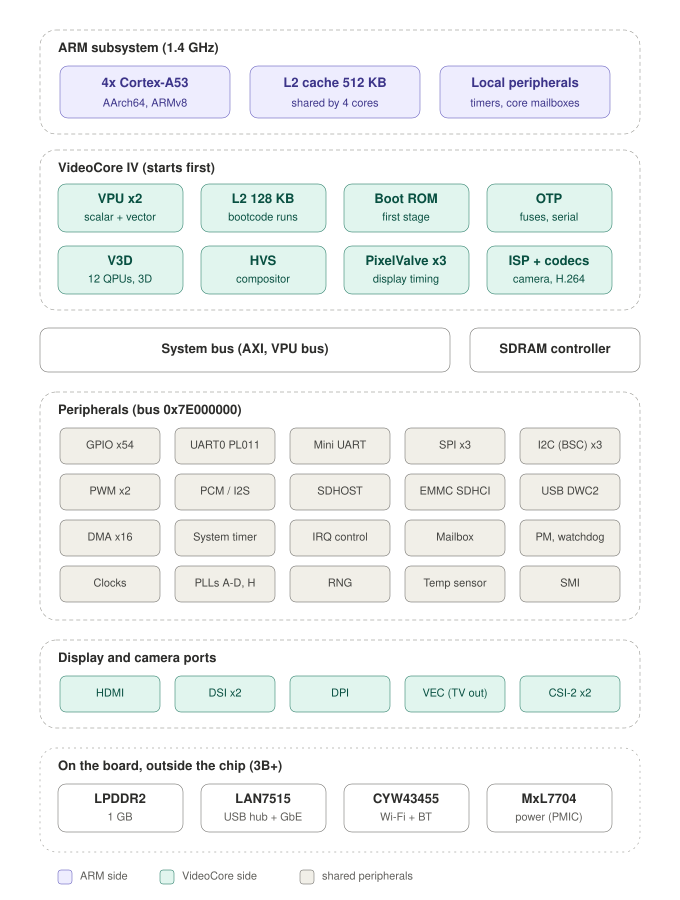

# Raspberry Pi 3 Model B+

What we know about the 3B+'s hardware: from Broadcom's and Raspberry Pi's
public documents, the Linux devicetree, and our own measurements on the
test Pi (pi-tests rows, the open firmware's monitor). Overview of all
models: [models.md](../models.md). The closed files it boots with:
[broadcom/](../broadcom/README.md).



## Board

| | |
|---|---|
| SoC | BCM2837B0 (the BCM2837 in a new package with a heat spreader) |
| ARM | 4 × Cortex-A53 (ARMv8-A, AArch64), up to 1.4 GHz, 512 KB shared L2 |
| VPU / GPU | VideoCore IV: two VPU cores (scalar + 16-lane vector unit), V3D with 12 QPUs, HVS, three pixel valves |
| RAM | 1 GB LPDDR2 (ours: Elpida), on the back of the board, 32-bit |
| Crystal | 19.2 MHz |
| Power chip | MaxLinear MxL7704, I2C address `0x1D` (see below) |
| USB / Ethernet | Microchip LAN7515: USB 2.0 hub and gigabit Ethernet, behind the SoC's only USB port |
| Wi-Fi / Bluetooth | Cypress CYW43455, 2.4 and 5 GHz, Wi-Fi on SDIO, Bluetooth on a UART |
| Display | HDMI (full size), DSI connector, composite on the 3.5 mm jack |
| Camera | CSI-2 connector |
| Audio | 3.5 mm jack from two PWM channels, HDMI audio |
| Revision code | ours: `a020d3` (rev 1.3, 1 GB, Sony UK) |
| Supply | 5 V, 2.5 A over micro-USB |

## Address maps

Three views of the same chip:

| Range | Who sees it there |
|---|---|
| `0x7E000000` | **bus addresses** of the peripherals (as in Broadcom's documents and the devicetree) |
| `0x3F000000` | the same peripherals from the **ARM** (physical address) |
| `0x40000000` | the ARM's own local block (BCM2836-style: per-core timers, mailboxes, interrupt routing); ARM only |
| `0x00000000`–`0x3EFFFFFF` | SDRAM from the ARM (minus the VPU's part at the top) |
| `0x80000000`, `0xC0000000` | SDRAM from the VPU: cached (L2) and uncached aliases; `0x80000000` is also where `bootcode.bin` runs in the L2 cache |

The ARM reaches the SDRAM and peripherals through a mapping the VPU sets
up before it starts the ARM (`ARM_CONTROL0` and the ARM translation
registers at `0x7E00B000`).

## Boot

1. **Boot ROM** on the VPU. It reads the OTP to see which boot modes are
   on; the 3B+ comes with SD, USB mass storage and network boot enabled.
2. It loads `bootcode.bin` (up to 128 KiB) from the SD card's first FAT
   partition into the L2 cache at `0x80000000` and jumps to `0x80000200`.
   No card: USB, then network boot through the LAN7515.
3. From there on the firmware: [broadcom/](../broadcom/README.md) for
   Broadcom's, [own-firmware.md](../own-firmware.md) for ours.
4. The ARM cores start in EL3 at address 0 (`armstub8`). Cores 1–3 wait on
   the spin table at `0xE0`, `0xE8`, `0xF0`.

The ROM waits about 2 s before it runs `bootcode.bin`; why is not known.

## ARM

- **Exception levels:** EL3 at reset; the stub drops to EL2.
- **Interrupts:** no GIC. The ARM local block at `0x40000000` routes the
  per-core timer interrupts and has four mailboxes per core (used for
  IPIs); the BCM2835 interrupt controller at `0x7E00B200` handles the
  peripherals and sends them to one core.
- **Timer:** the generic timer at 19.2 MHz (`CNTFRQ_EL0` set by the stub).
- **Starting cores:** spin table only; there is no PSCI unless something
  like TF-A runs at EL3.
- **APROT:** `ARM_CONTROL0` bits 12–15 decide how the ARM's accesses to
  the ARM control block (`0x7E00B000`, with the mailbox at `0x7E00B880`)
  are checked. With `APROTPASS` (`0xA000`) the user/system bit is passed
  on, so EL0 code reads 0 and its writes are dropped. With `APROTSYST`
  (`0xF000`) every access counts as system, and EL0 drivers can use the
  mailbox. Broadcom's firmware sets the second (pi-tests rows 399, 402).

## Clocks

| Clock | Source | Values we have seen |
|---|---|---|
| Crystal | 19.2 MHz | – |
| PLLA | VCO, for the VPU's other clocks | moved around by the firmware at run time |
| PLLB | ARM clock: VCO = 19.2 MHz × (NDIV + FRAC/2²⁰), divided by `A2W_PLLB_ARM` | 600–1400 MHz under Broadcom's firmware; our firmware sets 600–1200 MHz with the VCO between 600 and 1750 MHz (row 405) |
| PLLC | VPU core clock | 500 MHz in the 2019 open firmware |
| PLLD | peripherals (EMMC, UART) | – |
| PLLH | HDMI pixel clock | 1485 MHz, `pllh_pix` 148.5 MHz at 1080p60 (socdump, row 337) |
| DDR PLL | SDRAM | 398.4 MHz under our firmware (row 265); Broadcom's runs the 3B+'s at a higher rate |

The clock manager (`cprman`) is at `0x7E101000`; `CM_LOCK` bit 9 says
PLLB has locked.

## Power chip: MxL7704

Four buck converters and an LDO, on a bit-banged I2C bus at GPIO 46 (SDA)
and 47 (SCL), address `0x1D`. The devicetree's line names say the
opposite (46 `SMPS_SCL`, 47 `SMPS_SDA`), but the chip answers only with
SCL on 47 (row 366; firmware pin defines agree). It reads one register per transfer (no
auto-increment). From the datasheet (Rev 1B) and our reads (rows 407,
409):

| Register | What | Power-on | Under Broadcom's firmware at 1.4 GHz |
|---|---|---|---|
| `0x10` | LDO, 20 mV steps | `A5` | `A5` |
| `0x11` | Buck 1, 20 mV steps | `A5` | `A5` |
| `0x12` | Buck 2, 20 mV steps | `5A` | `5A` |
| `0x13` | Buck 3, 6.25 mV steps: the SDRAM rail | `C0` = 1.200 V | `C8` = 1.250 V |
| `0x14` | Buck 4, 6.25 mV steps, 0.6–1.39375 V, 4 A: the **core** rail (ARM, VPU) | `C0` = 1.200 V | `D9` = 1.35625 V |
| `0x1A` | power good / undervoltage: bit 7 warning temperature, bit 6 UV seen, bit 5 UV now, bits 4–0 PG | `7F` | `3F` |
| `0x1B` | temperature | `77` | `79` |

At 1200 MHz the ARM runs stable at the power-on voltage; at 1400 MHz it
locks but stalls without the higher core voltage (row 405).

## Memory

- 1 GB LPDDR2, recognised by its mode register (MR8 = `0x58`).
- `bootcode.bin` brings it up. It first sets the size to 256 MB and skips
  its set-up when `SD_CS` bit 0 is already set.
- The VPU takes the top `gpu_mem` MB (16 MB with `start_cd.elf`, 76 MB by
  default); the ARM gets the rest (998 MiB with `gpu_mem=16`, as U-Boot
  and Redox report).

## Peripherals

All at bus `0x7E…`, ARM `0x3F…`:

| Block | Bus address | Notes |
|---|---|---|
| System timer | `0x7E003000` | 1 MHz free-running counter |
| DMA | `0x7E007000` | 16 channels |
| Interrupt controller | `0x7E00B200` | |
| Mailbox | `0x7E00B880` | ARM ↔ VPU; channel 8 is the property interface |
| Watchdog, power | `0x7E100000` | reset through `PM_RSTC`/`PM_WDOG`, power domains |
| Clock manager | `0x7E101000` | PLLs and dividers |
| RNG | `0x7E104000` | |
| GPIO | `0x7E200000` | 54 pins, 6 alternate functions each |
| PL011 UART | `0x7E201000` | the console with `disable-bt` (GPIO 14/15) |
| SDHOST | `0x7E202000` | SD card by default |
| I2C | `0x7E205000`, `0x7E804000`, `0x7E805000` | BSC0 (camera/display), BSC1 (header), BSC2 (HDMI) |
| SPI | `0x7E204000` | plus two in the AUX block |
| PWM | `0x7E20C000` | two channels, the audio jack |
| AUX | `0x7E215000` | mini UART (`0x7E215040`), SPI1, SPI2 |
| Arasan SDHCI | `0x7E300000` | Wi-Fi by default; the SD card with `dtoverlay=mmc` |
| HVS | `0x7E400000` | display compositor |
| Pixel valves | `0x7E206000`, `0x7E207000`, `0x7E807000` | display timing; PV2 drives HDMI |
| HDMI | `0x7E902000` | with the HD block at `0x7E808000` |
| USB (DWC2) | `0x7E980000` | OTG controller, host mode only on this board |
| V3D | `0x7EC00000` | 3D unit |

## GPIO on the board

| GPIO | Use |
|---|---|
| 0–27 | the 40-pin header (14/15 UART, 2/3 I2C1, 7–11 SPI0, 18/19 PCM, …) |
| 0/1 | `ID_SDA`/`ID_SCL`: HAT EEPROM (header pins 27/28) |
| 28 | `HDMI_HPD_N`: HDMI hot-plug detect |
| 29 | `STATUS_LED_G`: the green ACT LED |
| 30–33 | `CTS0`, `RTS0`, `TXD0`, `RXD0`: PL011 to Bluetooth (without `disable-bt`) |
| 34–39 | `SD1_*`: SDIO to the Wi-Fi chip |
| 40/41 | `PWM0_OUT`, `PWM1_OUT`: audio jack |
| 42/43 | `ETH_CLK`, `WIFI_CLK` |
| 44/45 | `SDA0`/`SCL0` |
| 46/47 | I2C to the PMIC (bit-banged, see above) |
| 48–53 | `SD_*_R`: SD card |

The firmware's **GPIO expander** (reached over the mailbox) has 8 more
lines: `BT_ON`, `WL_ON`, `PWR_LED_R` (the red LED), `LAN_RUN`,
`CAM_GPIO0`, `CAM_GPIO1`, two not connected. Names from the devicetree's
`gpio-line-names`.

## USB and Ethernet

```
DWC2 root port (SoC)
└─ LAN7515, USB 2.0 hub (0424:2514, 4 ports)
   └─ second hub level (0424:2514, 3 ports)
      └─ 0424:7800 Ethernet (LAN7800)
```

- One USB 2.0 port in the SoC carries all four USB sockets and the
  Ethernet, so Ethernet tops out at about 300 Mbit/s.
- The DWC2 controller needs a host driver with split transactions for the
  full- and low-speed devices behind the hubs (keyboards).
- The LAN7800 takes its MAC address from the devicetree, which the firmware
  fills in from the OTP (`b8:27:eb:…`).

## SD card

- Two controllers can drive it: SDHOST (Broadcom's own, used by the
  firmware) and the Arasan SDHCI (standard SDHCI 3.0). See
  [broadcom/mmc.dtbo.md](../broadcom/mmc.dtbo.md).
- The 3B+ gives the card 3.3 V only (no 1.8 V switching, so no UHS-I
  modes).

## Serial console

- PL011 on GPIO 14 (pin 8, TXD) and 15 (pin 10, RXD), ground on pin 6,
  3.3 V levels, 115200 8N1. Needs `dtoverlay=disable-bt`; see
  [broadcom/disable-bt.dtbo.md](../broadcom/disable-bt.dtbo.md).
- `uart_2ndstage=1` makes `bootcode.bin` and `start.elf` log there too.

## OTP

One-time-programmable fuses read by the Boot ROM and the firmware: boot
modes (USB and network boot are set on the 3B+), the board revision code,
the serial number, and the MAC address. Writing them is permanent; our
firmware only reads.

## Close relatives

The **Pi 3 Model B** (BCM2837, 1.2 GHz, LAN9514 with 100 Mbit Ethernet, no
PMIC with I2C) and the **Pi Zero 2 W** (RP3A0 = BCM2710A1 + 512 MB in one
package, 1 GHz, no Ethernet, no USB hub, one OTG port) have the same
peripherals at the same addresses. Their devicetrees are
`bcm2710-rpi-3-b.dtb` and `bcm2710-rpi-zero-2-w.dtb`.
